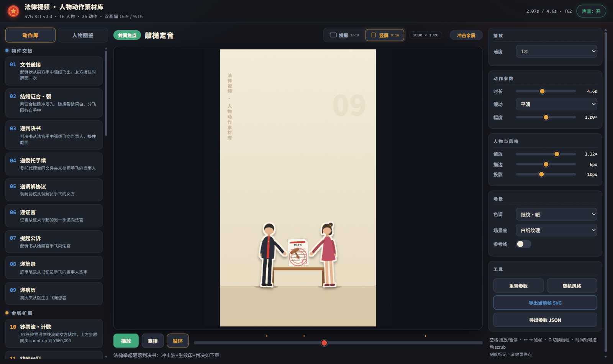
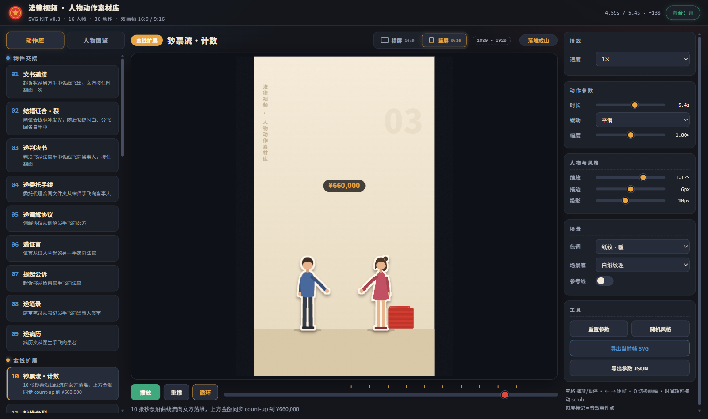
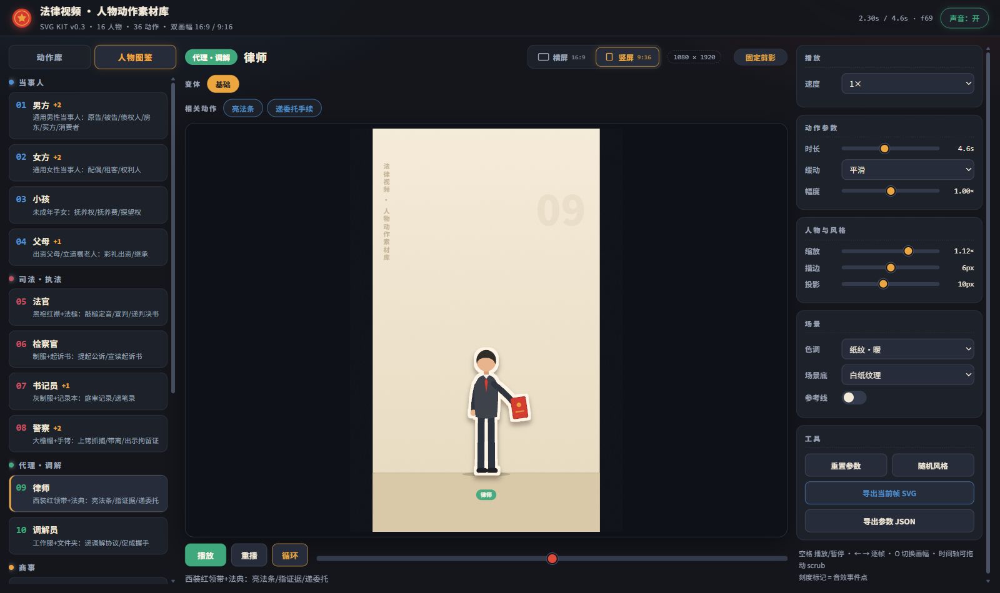

# lawyer-svg-kit · 法律视频一站式 Skill

**资产层 + 制作层** 合一的法律科普 / 案件讲解视频 Skill：
接到案件稿件 → 选画幅 → 选角选动作 → 分镜与时间轴 → 合成整片（零依赖管线或 Remotion）→ 逐镜头验收交付。

本仓库由原 `lawyer-video`（整片制作流程）与 `lawyer-svg-kit`（人物动作资产库）合并而成：资产库负责"画面里有什么"，制作流程负责"怎么拼成一条片子"，入口统一在 `SKILL.md`。

## 资产层：人物动作素材库

- **16 个固定剪影人物**（无表情、色块轮廓、贴纸描边）+ **14 个换装变体**，覆盖当事人 / 司法·执法 / 代理·调解 / 商事 / 民生 / 对抗六组、11 个业务领域。
- **36 个动作**：文书递接、结婚证合裂、钞票流计数、钱堆分裂、敲槌定音、上铐抓捕、带离现场、抢公章、促成握手、抚养权归属、限高灰化、转移财产曝光……
- **9 个动作工厂**：新动作多数只需一行配置拼出来；缺人物/缺动作有现造教程。
- **51 个法律图标**（`assets/legal-svg/`：天平/法槌/文书/证据/案件类）+ 图标级动效组件 `remotion/LegalMotion.tsx`。
- **纯时间函数**：所有画面状态 = `f(t)`，可 scrub、可逐帧导出、可直接移植 Remotion。
- **零依赖镜头模块**（v0.5 `camera.js`）：push/hold/impact/pan/breathe 五种运镜 preset，与 Remotion CameraRig 同一套数学；预览台"镜头"下拉实时切换。
- **6 种场景底**：白纸 / 家中 / 法庭 / 登记处 / 办公室 / 仓库，按剧情地点选，双画幅自动映射。
- **双画幅·单选生成**：横屏 16:9（1920×1080）或竖屏 9:16（1080×1920），每个项目选其一生成；坐标自动重排，竖屏上方留标题/字幕安全区。
- **零依赖预览台**：无构建、无 npm 包，浏览器打开即用。


| 敲槌定音 | 上铐抓捕 |
|---|---|
|  |  |

## 制作层：整片生产流程

- **六阶段工作流**（`references/workflow.md`）：读懂任务 → 时间轴 → 分镜 → 选角与动作准备 → 合成 → 验收交付。
- **两条合成路线，二选一**：
  - **零依赖管线**（v0.5 `pipeline/`，默认推荐）：film.config.js 配置 → render.cjs 本机 Edge/Chrome 逐帧截图 → compose.sh 合成。内置镜头推拉、双缓冲交叉淡化、6 种场景底、真人左下角 Ø300 小圆、ASS 字幕、音效混音与 loudnorm，不需要 npm/React。
  - **Remotion 合成配方**（`references/remotion.md`）：kit 打包成 ES 模块、`KitShot` 组件逐帧驱动、人物小窗 + 字幕 + 镜头层整片骨架，版本组合已验证。
- **口播对齐**：`scripts/prepare_timing.py` 把剪映 SRT + ffprobe 时长转成 `timing.json`（校验格式/顺序/重叠）。
- **声音两层（v0.8 真实素材）**：成片 = 口播 + 动作音效，**无 BGM**（律师要求只要音效）。音效 = `assets/sfx` CC0 真实录音库（7 音套件 + 100 条备选，无 whoosh）；`scripts/mix_sound.py` 把口播+音效混音（ogg/mp3 自动解码，无 ducking）。**转场/翻页静音**（whoosh 已移除）。`make_sfx.py` 为离线合成兜底。见 references/sound.md。
- **叙事与镜头**：事实表先行、revealAt 节奏、反幻灯片清单 + 可执行动感下限（`narrative.md`）；运镜与景深规则（`camera.md` + `camera.js` / `remotion/CameraRig.tsx`）。
- **两级验收**（`delivery-qa.md`）：资产级预览台 sweep → 成片级 MP4 逐镜头复核 + freezedetect 冻结门禁 + 数字停帧抽查。

## 双画幅 · 横屏 16:9 / 竖屏 9:16（单选）

画幅是项目级单选：Skill 开工前确认律师选横屏还是竖屏（稿件没写就先问），**只生成选中的那一种**。预览台舞台头的 **横屏 / 竖屏** 切换（或 `O` 键）就是选择入口，选定自动保存、重置/随机不改变；导出 SVG/JSON 跟随当前画幅。横屏拉开双人距离，竖屏保持交接手距、把计数 chip 抬进天空区，上方约 40% 留给标题与字幕。

| 横屏 16:9 · 1920×1080 | 竖屏 9:16 · 1080×1920 |
|---|---|
|  |  |

竖屏钞票流：金额计数器自动抬升、钱堆照旧落堆；人物图鉴同样支持双画幅：

| 竖屏钞票流 | 竖屏人物图鉴 |
|---|---|
|  |  |

移动端自适应：


## 快速开始

### 预览台（资产层）

```bash
git clone https://github.com/XJHwxjb/lawyer-svg-kit.git && cd lawyer-svg-kit
python -m http.server 8734
# 打开 http://127.0.0.1:8734/index.html
```

- 左上切换 **动作库 / 人物图鉴**；图鉴里点角色看肖像、点变体换装、点"相关动作"直接播放。
- 舞台头切换 **横屏 16:9 / 竖屏 9:16**（`O` 键同效）= 项目画幅单选，自动保存；旁边徽章显示当前画布尺寸。
- 右栏实时调速度 / 缓动 / 幅度 / 缩放 / 描边 / 投影 / 色调 / 场景底；时间轴可 scrub，刻度是音效事件点。
- 工具区可导出 **当前帧 SVG**（独立文件，尺寸即当前画幅）与 **参数 JSON**（含 orientation 块，供 Remotion / 剪辑对轨）。

### 整片制作（制作层）

按 `SKILL.md` §3 路由到 `references/workflow.md`，合成二选一：

- **零依赖管线（默认）**：照 `pipeline/README.md` 把模板复制进案件工程，分镜逐行填进 `film.config.js`，`node render.cjs` → `bash compose.sh`。
- **Remotion**：`references/remotion.md` 的 KitShot 配方——把 `kit.js + actions.js` 拼成带 export 的 bundle，Remotion 里 build 一次、每帧只调 `update(t01, P)`，与口播/字幕/镜头层合成。

## 作为 Skill 安装

把本仓库整体放入 Agent 的 skills 目录（或按所用平台的 skill 安装方式导入），入口为 `SKILL.md`：

```
SKILL.md                        统一入口：硬约束 + 路由表 + 两层流程 + 自检清单
references/workflow.md          整片六阶段工作流（含画幅单选规则）
references/narrative.md         叙事节奏：事实表 / revealAt / 反幻灯片 / 动感下限与数字模式
references/remotion.md          Remotion 合成配方（bundle / KitShot / 整片骨架）
references/camera.md            运镜与景深规则（camera.js 零依赖 + CameraRig Remotion）
references/legal-icons.md       51 法律图标使用指南
references/delivery-qa.md       两级验收 + 可执行门禁 + 声音设计 + 成片检查
references/roster.md            16 人物 × 变体 × 36 动作总表 + 11 领域组合矩阵
references/character-forge.md   造人物教程（剪影语法 / 坐标契约 / 完整示例）
references/action-forge.md      造动作教程（9 工厂选项表 / 自定义机制骨架 / 验收清单）
references/studio.md            预览台 / 自动化验收 / 导出 / 坐标契约
camera.js                       零依赖镜头模块（preset / cameraAt / applyCamera）
pipeline/                       零依赖整片模板（film.html / config / render.cjs / compose.sh / README）
remotion/                       CameraRig / LegalMotion / DocumentTransition 组件
assets/legal-svg/               51 图标 + catalog.json + 预览图
assets/sfx/                     真实录音音效库（7 音套件 + lib/ 100 条 + manifest.json + LICENSES.md）
scripts/prepare_timing.py       SRT + ffprobe → timing.json
scripts/mix_sound.py            口播+音效 两层混音（无 BGM/ducking，ogg/mp3 自动解码）
scripts/make_sfx.py             合成音效兜底（ffmpeg 7 音）
```

Skill 的工作方式：读稿 → 确认画幅 → 拆出角色与动作清单 → 查 roster 命中直接用，未命中按 forge 教程造并回写 roster → 分镜/时间轴 → 合成（pipeline 或 Remotion）→ 预览台与成片两级验收 → 交付。

## 目录结构

```
kit.js        基础构建器：坐标契约 / 剪影语法 / 人物 draw / 道具 / makeChar / 6 种场景底
camera.js     零依赖镜头模块（与 CameraRig 同数学，按 t01 求值）
actions.js    动作工厂 + 36 动作定义（cast / phases / events）
app.js        预览台驱动（时钟 / 控件 / WebAudio 音效 / 导出 / 双模式库）
index.html    预览台页面
style.css     预览台样式
references/   两层流程文档与教程（10 篇）
pipeline/     零依赖整片模板（配置 → 逐帧渲染 → 合成）
remotion/     整片用 React 组件（运镜 / 图标动效 / 文书转场）
assets/       legal-svg 图标库 · sfx 真实录音音效库
scripts/      prepare_timing.py 口播对齐 · mix_sound.py 口播+音效两层混音 · make_sfx.py 合成兜底
docs/         README 用图
qa/           开发期验收截图（不入库，.gitignore 排除）
```

## 技术要点

- 设计空间 `1080×800`、地面 `y=700`；活画幅 land `1920×1080/GROUND=945`、port `1080×1920/GROUND=1640`，经 `X/Yg/Ys` 自动映射；人物局部坐标脚底原点、向上为负。
- 贴纸描边 = `feMorphology dilate → feFlood 米白 → feDropShadow`；灰化 = 内层 `saturate()`。
- 动作契约 `build(S) → { update(t01,P), anchors(P), guidePath(P) }`；`S.chars` 按 cast 装配。
- 镜头契约（v0.5）：`cameraAt(t01, keys[{at,x,y,scale}])` + `applyCamera(g, cam)`；焦点 `camFocus(x,y)` 用设计空间坐标；全舞台镜头 scale ≥ 1；pipeline 的 film.html 用双世界槽做帧级确定性交叉淡化。
- Remotion 移植：`setOrientation` 先于 build；全局帧与局部帧不混用；已验证版本 remotion 4.0.534 / react 19.2.0 / typescript 5.9.2。
- 预览台音效由 WebAudio 即时合成（近似音，绑定可见事件点 paper/ching/thud/stamp/crack/pop/scratch，无 whoosh）；成片声音两层走真实素材：assets/sfx 录音库 + mix_sound.py（口播+音效，无 BGM），按 `events[].at × dur` 对轨；转场/翻页静音。

## 使用约束

- 库内金额、法条编号为**演示默认值**；成片必须替换为稿件提供的真实值，不得编造法律事实。
- 当事人私密材料（稿件/证据/肖像）只存放在授权位置；本仓库不含任何真实案件信息，不得把私密内容上传到第三方服务或公开仓库。
- 人物风格为无表情极简剪影（已定稿），不引入五官表情或写实风格。

## 许可

代码 MIT，见 [LICENSE](LICENSE)。

第三方音频素材：`assets/sfx` 为 CC0 1.0 真实录音（98 条）+ 2 条 MIT 合成音，
逐条来源与声明见 [assets/sfx/LICENSES.md](assets/sfx/LICENSES.md)。v0.8 只用音效、
无 BGM（Mixkit 曲目下载链路已移除）。
