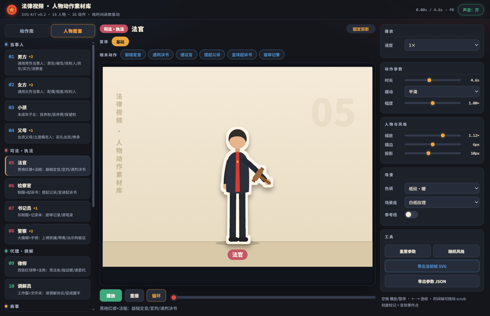
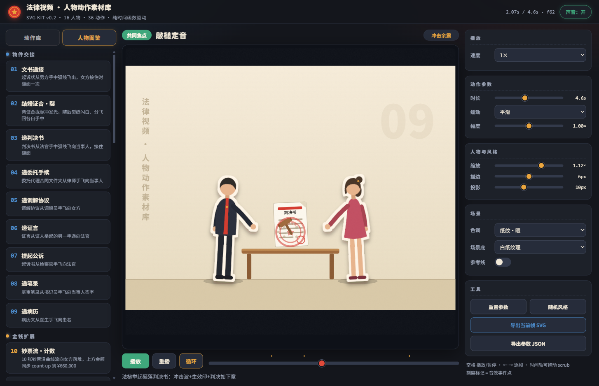
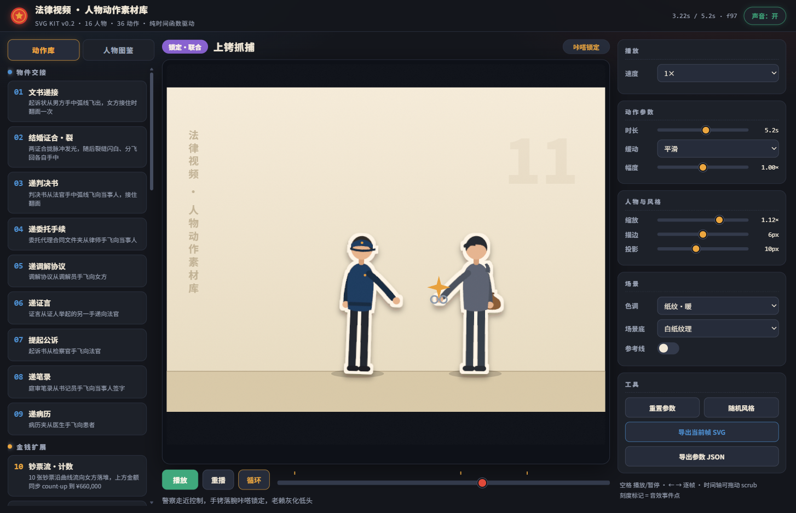
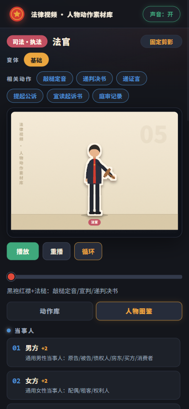

# lawyer-svg-kit · 法律视频人物动作素材库

面向法律科普 / 案件讲解视频的 **纯 SVG 人物 + 动作动画库**，同时是一个可安装的 Agent Skill：
接到案件 → 分析选角 → 查库 → 缺人物/缺动作按教程现造 → 预览验收 → 导出进片。

- **16 个固定剪影人物**（无表情、色块轮廓、贴纸描边）+ **14 个换装变体**，覆盖当事人 / 司法·执法 / 代理·调解 / 商事 / 民生 / 对抗六组、11 个业务领域。
- **36 个动作**：文书递接、结婚证合裂、钞票流计数、钱堆分裂、敲槌定音、上铐抓捕、带离现场、抢公章、促成握手、抚养权归属、限高灰化、转移财产曝光……
- **9 个动作工厂**：新动作多数只需一行配置拼出来。
- **纯时间函数**：所有画面状态 = `f(t)`，可 scrub、可逐帧导出、可直接移植 Remotion。
- **零依赖**：无构建、无 npm 包，浏览器打开即用。



| 敲槌定音 | 上铐抓捕 |
|---|---|
|  |  |

移动端自适应：



## 快速开始

```bash
git clone <repo-url> && cd lawyer-svg-kit
python -m http.server 8734
# 打开 http://127.0.0.1:8734/index.html
```

- 左上切换 **动作库 / 人物图鉴**；图鉴里点角色看肖像、点变体换装、点"相关动作"直接播放。
- 右栏实时调速度 / 缓动 / 幅度 / 缩放 / 描边 / 投影 / 色调 / 场景底；时间轴可 scrub，刻度是音效事件点。
- 工具区可导出 **当前帧 SVG**（独立文件）与 **参数 JSON**（供 Remotion / 剪辑对轨）。

## 作为 Skill 安装

把本仓库整体放入 Agent 的 skills 目录（或按所用平台的 skill 安装方式导入），入口为 `SKILL.md`：

```
SKILL.md                      案件选角流程 + 硬约束（隐私/事实/风格）
references/roster.md          16 人物 × 变体 × 36 动作总表 + 11 领域组合矩阵
references/character-forge.md 造人物教程（剪影语法 / 坐标契约 / 完整示例）
references/action-forge.md    造动作教程（9 工厂选项表 / 自定义机制骨架 / 验收清单）
references/studio.md          预览台 / 自动化验收 / 导出 / Remotion 移植
```

Skill 的工作方式：读稿拆出角色与动作清单 → 查 roster → 命中直接用；未命中按 forge 教程造并回写 roster → 预览台验收 → 导出。

## 目录结构

```
kit.js        基础构建器：坐标契约 / 剪影语法 / 人物 draw / 道具 / makeChar
actions.js    动作工厂 + 36 动作定义（cast / phases / events）
app.js        预览台驱动（时钟 / 控件 / WebAudio 音效 / 导出 / 双模式库）
index.html    预览台页面
style.css     预览台样式
references/   教学与总表
docs/         README 用图
qa/           开发期验收截图（不入库，.gitignore 排除）
```

## 技术要点

- 舞台 `1080×800`，地面 `y=700`；人物局部坐标脚底原点、向上为负。
- 贴纸描边 = `feMorphology dilate → feFlood 米白 → feDropShadow`；灰化 = 内层 `saturate()`。
- 动作契约 `build(S) → { update(t01,P), anchors(P), guidePath(P) }`；`S.chars` 按 cast 装配。
- 音效全部由 WebAudio 合成并绑定可见事件点（whoosh/paper/ching/thud/stamp/crack/pop/scratch）。

## 使用约束

- 库内金额、法条编号为**演示默认值**；成片必须替换为稿件提供的真实值，不得编造法律事实。
- 当事人私密材料只存放在授权位置；本仓库不含任何真实案件信息。

## 许可

内部项目素材，未附开源许可证；对外分发前请先确认授权。